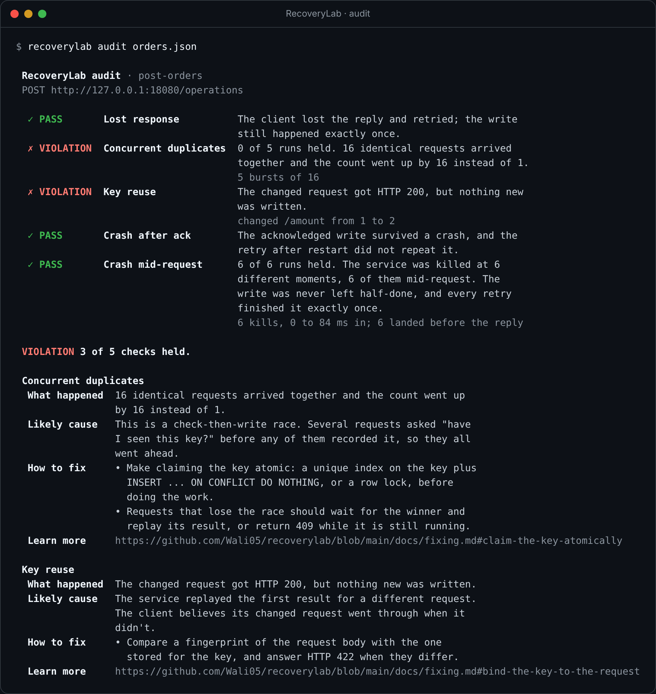
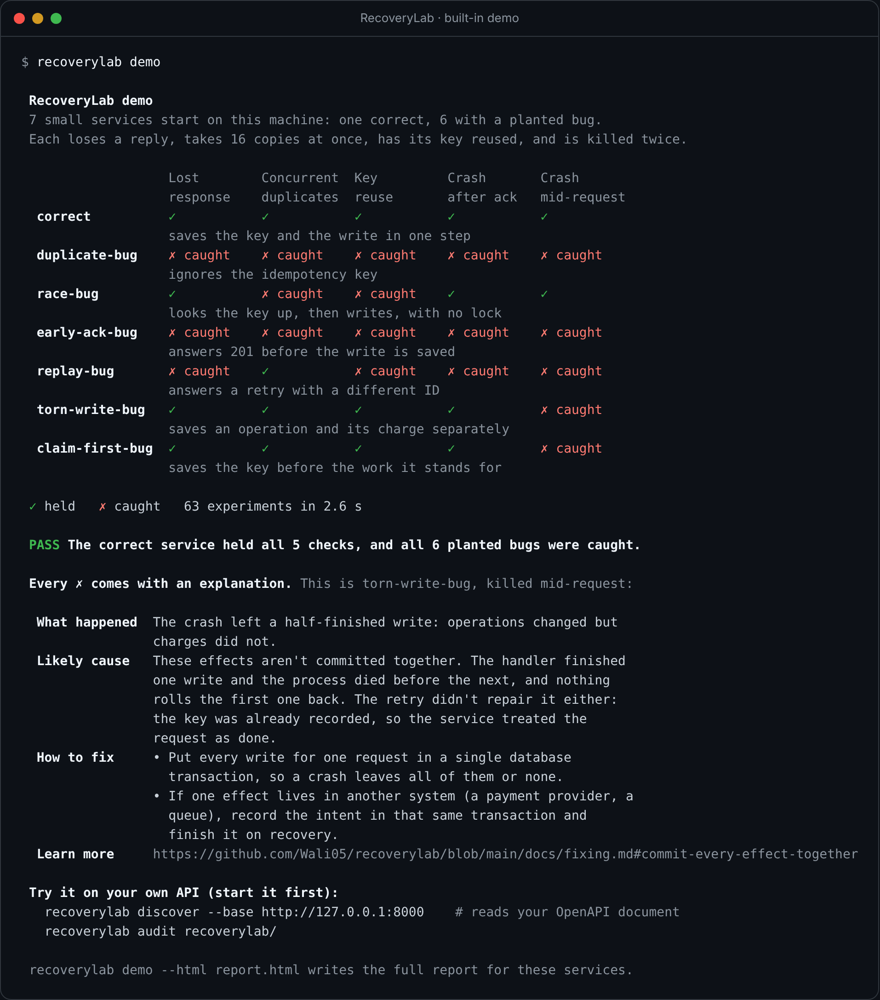
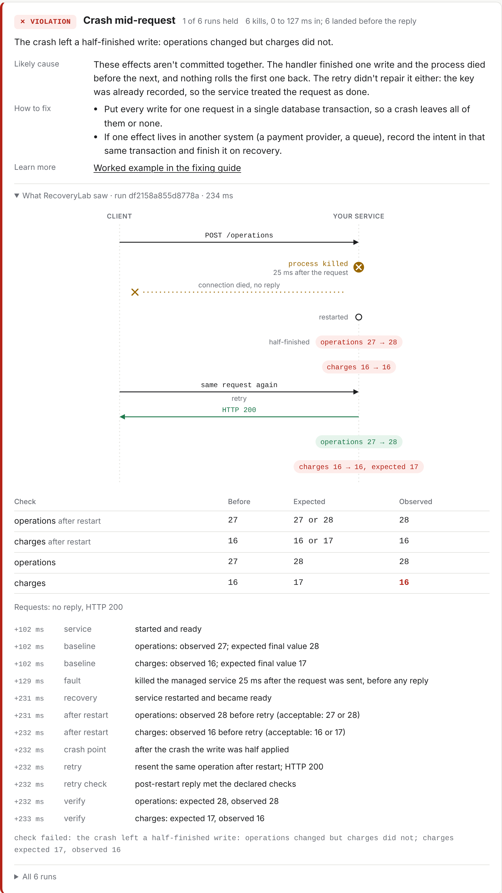

# RecoveryLab

[](https://github.com/Wali05/recoverylab/actions/workflows/ci.yml)
[](https://github.com/Wali05/recoverylab/releases/latest)
[](LICENSE)

**A local failure lab for APIs that write data.**

Imagine your API creates an order and sends `200 OK`, but the response disappears on the way back. The client retries. RecoveryLab recreates that moment, then checks whether the order was created once or twice.

It can also send duplicate requests at the same time, reuse an idempotency key for a *different* request, kill your service right after it answers, or kill it **in the middle of the request** and check that nothing was left half-done. Each time, it checks what actually changed in the state your service exposes instead of trusting the HTTP status. When something breaks, it tells you what happened, the likely cause, and what usually fixes it.



## See it run

With [Go 1.23+](https://go.dev/dl/) installed, run this from the repository root:

```sh
go run ./cmd/recoverylab demo
```

The demo starts seven small services on your machine: one that handles retries correctly, and six that each have one deliberate bug. Every service gets all five failures, 63 experiments in about three seconds. You don't need Docker, an account, or an API key.



Read it by row. `race-bug` looks a key up and then writes without a lock, so it survives a lost reply but not 16 copies at once. `torn-write-bug` and `claim-first-bug` pass everything until they are killed mid-request. A `✗` is the *correct* result for a service with a planted bug; the demo fails if RecoveryLab misses one, or flags the correct service.

`recoverylab demo --html report.html` also writes the full report for all seven.

The planted bugs are built to be reproducible. A race in your own service may take several runs to catch.

## Check your own API

[Install RecoveryLab](#install) (or use `go run ./cmd/recoverylab` from a clone) and start your service locally.

**If it has an OpenAPI document**, which FastAPI, Spring with springdoc, ASP.NET Core, and NestJS can all serve, two commands cover every write endpoint:

```sh
recoverylab discover --base http://127.0.0.1:8000
recoverylab audit recoverylab/
```

`discover` finds the document at the usual paths (`/openapi.json`, `/v3/api-docs`, `/openapi/v1.json`, `/swagger/v1/swagger.json`, `/api-json`, and a few more), or you can pass `--openapi` with a URL or file. For each `POST` it builds a body from the schema (required fields, examples, enums, formats, and length limits) and pairs it with the `GET` on the same path to count the effect. It checks that list against the live service before writing anything. Endpoints it can't handle on its own are listed with the reason, such as a path parameter that needs `--param id=42`. String values include `{{run_id}}`, so a unique email or username doesn't collide on the next run. Look over the generated bodies before trusting the verdicts. It reads JSON documents only.

**For a single endpoint**, point `init` at the write and at something that shows its effect. That can be a count, or just the list endpoint:

```sh
recoverylab init --url http://127.0.0.1:8080/orders --state http://127.0.0.1:8080/orders --body '{"sku":"book","quantity":1}'
recoverylab audit recoverylab.json
```

`init` reads the state endpoint, finds the numbers and lists that could count the write, and saves a scenario using the most likely one. Both commands add an `Idempotency-Key` header with a fresh value per run; pass `--no-key` if your API identifies operations another way, and `--header 'Authorization: Bearer …'` for auth.

`audit` takes one scenario, several, or a folder, and runs every failure that applies to each request. On a terminal it shows which check is running:

- **Lost response:** the reply vanishes and the client retries. The retry must succeed and return the same IDs as the lost reply, so `"id"` or `"order_id"` can't change. Fields meant to differ per request, such as `request_id`, are ignored.
- **Concurrent duplicates:** five bursts of 16 identical requests (`--bursts` changes the count), because a race doesn't show up every time. Besides the count, no copy may get a 5xx. A duplicate that arrives mid-request should get 409, as the [IETF Idempotency-Key draft](https://datatracker.ietf.org/doc/html/draft-ietf-httpapi-idempotency-key-header) and [Stripe](https://docs.stripe.com/idempotency) do.
- **Key reuse:** the same key with one value in the body changed, such as `quantity` going from 1 to 2. Set `changed_body` to choose the change yourself.
- **Crash after ack:** RecoveryLab kills your process right after a 2xx, restarts it, checks the write survived, and retries. This one needs a [`service` block](#test-a-crash-after-a-successful-response) so RecoveryLab can start your server itself; otherwise it's skipped and the audit tells you why.
- **Crash mid-request:** the same kill, but while the request is still being handled. RecoveryLab measures how long your service takes to answer and spreads six kills across that time (`--crash-points` changes the count). After each restart the write must be all there or not there at all, and the retry must finish it exactly once. It also needs a `service` block. [More below](#test-a-crash-in-the-middle-of-a-request).

Every finding comes with an explanation written for the person who has to fix it. For a check-then-write race, that's the race itself, plus "make claiming the key atomic: a unique index on the key plus `INSERT ... ON CONFLICT DO NOTHING`". If RecoveryLab couldn't finish (nothing listening, a pointer that doesn't match, a first request that failed), it says so and suggests the next thing to try instead of handing you a stack trace. Each finding also links to [the fixing guide](docs/fixing.md), which shows the whole pattern: one table, one transaction, the replay, and the 409, with PostgreSQL and Go code.

To keep or share the result, add `--html report.html` for a single-file report that draws each run as a sequence diagram, `--junit report.xml` for your CI's test tab, `--markdown summary.md` for a pull request comment, or `--badge badge.svg` for your own README:

 

They all work with `run` too, and with several endpoints they combine into one report.



## Tested against real projects

Here are three checks outside the built-in demo:

| Service | Lost-response test |
| --- | --- |
| [NetCore](https://github.com/Wali05/NetCore), my own project | Allocation count `0 → 2`; `VIOLATION` when the test expected one. |
| [PocketBase](https://github.com/pocketbase/pocketbase), an unrelated project | Record count `0 → 2`; `VIOLATION` when the test expected one. |
| [Spring Boot idempotency sample](https://github.com/arthurfaby/spring-boot-starter-idempotency), an unrelated project | Ledger count `0 → 1`; `PASS` with the same idempotency key on the retry. |

Those results show what happened in these setups, not a bug in NetCore or PocketBase: neither tested endpoint promises idempotency. The Spring sample keeps its ledger in memory, so its passing result says nothing about crash recovery. See the [NetCore check](docs/independent-check.md) and [third-party checks](docs/external-checks.md) for the setups and limits.

A more focused check uses projects that actually promise safe retries. I tested [three idempotency projects](docs/idempotency-contract-checks.md): an Express middleware, a FastAPI decorator, and the Spring payment sample. Each handled ten lost-response runs with one effect and the same operation ID on retry. I then ran 100 bursts of 16 requests with the same key against each project. All 300 bursts had one effect; in-progress requests got 409 where expected. Turning off the guard in the Express and FastAPI hosts made every control burst create 16 effects. These are local contract checks, not discovered bugs in those projects.

For a restart check with a persistent store, I ran [idempot-js with SQLite](docs/persistent-idempotency-check.md). Its middleware kept one order and replayed the same ID in 20 process-crash runs. With the guard switched off in the test host, all five control runs created a second order. That checks this specific setup; it does not establish safety across database failures or crashes inside the write handler.

I also [checked changed-payload key reuse](docs/key-reuse-check.md) against the same SQLite-backed middleware. It rejected a changed order with HTTP 422 and kept one new order in all 20 runs. With the middleware disabled, five control runs each created a second order. Those are local contract checks, not upstream bug reports.

For breadth, I also tried the older state-only test against [20 small FastAPI repos](docs/compatibility-checks.md) and [27 Flask, Express, and Spring repos](docs/compatibility-checks-2.md). That historical sweep, including the three earlier checks, covered **50 distinct repos**; the SQLite check above is additional. The extra 47 are mostly educational CRUD apps, not a representative sample of production systems. In those runs, 36 created two records and 11 created one; ten of the 11 one-record runs returned an error on retry. Those are historical v0.1.2 verdicts; the current version would flag those ten rejected retries as violations. The linked notes preserve the original run data.

## Install

On macOS or Linux:

```sh
curl -fsSL https://raw.githubusercontent.com/Wali05/recoverylab/main/install.sh | sh
```

The [script](install.sh) downloads the latest release for your system, checks it against the published SHA-256 sums, and installs it to `~/.local/bin`. Set `RECOVERYLAB_VERSION=v0.6.0` to pick a version or `RECOVERYLAB_INSTALL_DIR` to pick the folder. It's short enough to read before you run it.

If you have Go 1.23 or newer:

```sh
go install github.com/Wali05/recoverylab/cmd/recoverylab@latest
recoverylab demo
```

Or [download the latest release](https://github.com/Wali05/recoverylab/releases/latest) for Windows, macOS, or Linux. Rename the file to `recoverylab` (`recoverylab.exe` on Windows) and put it on your `PATH`. On macOS and Linux, run `chmod +x recoverylab` first. The release includes SHA-256 checksums. The binaries aren't signed.

If you'd rather build it yourself, run `go build -o recoverylab ./cmd/recoverylab` from the repo (`go build -o recoverylab.exe ./cmd/recoverylab` on Windows).

## What it tests

| Scenario | What RecoveryLab does | What you learn |
| --- | --- | --- |
| `lost-response` | Lets the service process a request, drops the reply, then sends the same request again. | Whether a retry repeats the side effect and whether the client gets a successful reply. |
| `concurrent-duplicates` | Sends 2–64 copies of the same request together. | Whether this burst caused a duplicate side effect or returned a response code outside the optional list you allow. |
| `crash-after-ack` | Starts your service, sends a request, kills its process after a 2xx response, then restarts it. It can retry the same request after restart. | Whether the acknowledged effect survived, and whether the retry keeps the same result without a second effect. |
| `crash-mid-request` | Starts your service, sends a request, and kills the process a set time later, before it has answered. Restarts it, reads state, then retries. | Whether a crash can leave the write half-done, and whether the retry completes it exactly once. |
| `key-reuse` | Sends one request, changes its JSON body, and sends it again with the same idempotency key. | Whether the changed request is rejected with your declared 4xx code and leaves no second effect. |

RecoveryLab reads your state endpoint before and after the experiment. For each check, it compares the observed integer with `baseline + expected_delta`. A crash scenario with a retry also checks state before that retry. Lost-response retries, and post-restart retries when enabled, require a successful (2xx) reply by default. It can only judge the state and reply you expose; a passing run is not proof that every possible side effect is safe.

## Write a scenario by hand

`init` and `discover` write this file for you, but every setting is plain JSON you can edit. Add `"$schema": "https://raw.githubusercontent.com/Wali05/recoverylab/main/docs/scenario.schema.json"` at the top and editors such as VS Code will autocomplete settings and flag mistakes as you type. Use a disposable local service with a write endpoint and a `GET` endpoint that exposes the effect as an integer. Keep other writers out of the test while it runs. Here is a scenario for a service listening on `127.0.0.1:8080`:

```json
{
  "name": "order-is-created-once",
  "scenario": "lost-response",
  "request": {
    "method": "POST",
    "url": "http://127.0.0.1:8080/orders",
    "headers": {
      "Content-Type": "application/json",
      "Idempotency-Key": "recoverylab-{{run_id}}"
    },
    "body": { "sku": "book", "quantity": 1 }
  },
  "observe": {
    "url": "http://127.0.0.1:8080/state",
    "pointer": "/order_count",
    "expected_delta": 1
  },
  "retry_response": {
    "same_json_pointers": ["/order_id"]
  }
}
```

Save that as `scenario.json`, change the URLs and JSON pointers to match your service, then run:

```sh
go run ./cmd/recoverylab validate scenario.json
go run ./cmd/recoverylab run scenario.json
```

`run` performs only the scenario named in the file; `audit` ignores that field and runs all of them.

`validate` also rejects unknown settings and duplicate JSON keys, including keys nested in the request body, so an overwritten value cannot quietly change the experiment.

`{{run_id}}` is replaced once per run, so the original request and retry share a key, while the next run gets a fresh one. Put it in the idempotency key, URL, or JSON body wherever your service identifies an operation. If your API only accepts a UUID as a key, use `{{uuid}}` instead: it is a version 4 UUID derived from the run ID, so it is also the same for the request and its retry. The key header can be `Idempotency-Key`, `X-Idempotency-Key`, or `Idempotency_Key`. Make sure the state endpoint measures the thing you care about: an order count can reveal duplicate orders, while an HTTP 200 alone cannot.

The `retry_response` block compares a stable value in the original and retry replies. In this example, both replies must contain the same `/order_id`. Remove that block if your API doesn't return JSON with an order ID; the default 2xx retry check still runs. A different 2xx reply is allowed, such as `201 Created` followed by `200 OK`, as long as the selected values match. If your API contract deliberately returns a non-2xx code for duplicates, set `"allowed_statuses": [409]` inside `retry_response` to check for that code instead. Response bodies used for comparison are limited to 1 MiB and are not written to reports.

Your API doesn't need a special count endpoint. If `GET /orders` returns a list, point at the array and add `"measure": "length"`: `{ "url": "http://127.0.0.1:8080/orders", "pointer": "/data", "measure": "length", "expected_delta": 1 }`. Use `"pointer": ""` when the response itself is the array. A `null` list counts as zero. Paginated lists only show one page, so use a page size larger than the test data.

If the state endpoint needs authentication, add `"headers": { "Authorization": "Bearer {{env:API_TOKEN}}" }` inside `observe`, and the same in `request.headers` if the write needs it. `{{env:NAME}}` reads the variable when the scenario runs, so the token never sits in a file you commit, and a missing variable stops the run with its name. It works only in header values, which reports never include.

One count can hide another broken effect. To check several effects, replace `observe` with named `checks` (up to 16). For example, checking orders alone would miss a duplicate charge:

```json
{
  "checks": [
    { "name": "orders", "url": "http://127.0.0.1:8080/state", "pointer": "/order_count", "expected_delta": 1 },
    { "name": "charges", "url": "http://127.0.0.1:8080/state", "pointer": "/charge_count", "expected_delta": 1 }
  ]
}
```

Keep the `name`, `scenario`, and `request` fields from the first example; the block above only shows the replacement for `observe`.

To see the same flow without writing a service, start the included fixture in one terminal:

```sh
go run ./cmd/recoverylab fixture --mode correct --listen 127.0.0.1:8080 --journal .recoverylab/fixture.jsonl
```

Then, in a second terminal:

```sh
go run ./cmd/recoverylab run examples/lost-response.json
```

Stop the fixture before changing its mode. To try the duplicate bug, start it with `--mode duplicate-bug` and a **new journal path**, then run the same scenario. For overlapping requests, use [examples/concurrent-duplicates.json](examples/concurrent-duplicates.json) and the fixture's `race-bug` mode.

For a changed-payload test, run [examples/key-reuse.json](examples/key-reuse.json) against the `correct` fixture. It should return `PASS` with HTTP 422 and one write. Against `duplicate-bug` with a fresh journal, it should return `VIOLATION` with two writes. The scenario requires an `Idempotency-Key` header and two JSON bodies with a real value difference. If your API promises a different rejection status, add `"expected_reuse_status": 409` at the top level of the scenario. The default 422 comes from an [expired IETF Internet-Draft](https://datatracker.ietf.org/doc/html/draft-ietf-httpapi-idempotency-key-header#section-2.7); use your own API contract as the source of truth. See the [outside-project check](docs/key-reuse-check.md) for a reproduction recipe and measured results.

For a concurrent scenario, add `"concurrent_response": { "allowed_statuses": [201, 409] }` if your API returns 201 to the winning request and 409 while that request is still running. Any other code then becomes a `VIOLATION`, even if the final count is correct. Use the codes your API actually promises. Without this block, concurrent response codes are recorded but only the state checks decide the verdict.

For a Docker Compose service, [publish its HTTP port on host loopback](https://docs.docker.com/get-started/docker-concepts/running-containers/publishing-ports/), for example `ports: ["127.0.0.1:8080:8080"]`, and use `http://127.0.0.1:8080` in the scenario. RecoveryLab cannot directly address a container-only bridge IP from the host. The managed-process crash scenario requires a foreground process it can kill; it does not kill a Docker container.

### Test a crash after a successful response

This scenario needs a foreground service that RecoveryLab can start and kill. In the scenario above, change `scenario` to `crash-after-ack` and add a `service` key with this object as its value:

```json
{
  "command": ["/absolute/path/to/my-service", "--port", "8080"],
  "ready_url": "http://127.0.0.1:8080/health",
  "startup_timeout": "10s"
}
```

The service must store its data outside the process. The command runs without a shell, and RecoveryLab kills it together with everything it started, so `["npm", "start"]`, `["go", "run", "."]`, or a script that launches the server all work. Relative command paths use `service.working_dir`, which defaults to the scenario file's directory. Only run scenario files you trust: this command executes on your computer. Ctrl-C stops the experiment and the service with it.

RecoveryLab waits for `ready_url`, reads the baseline, sends the operation, kills the process after a 2xx response, restarts it, and reads state again. Use an endpoint whose 2xx response means the write should already be durable.

To also retry the same request after restart, add `"retry_response": { "same_json_pointers": ["/order_id"] }` to the scenario. RecoveryLab checks state **before** that retry, compares the two replies, then checks state once more. This catches a write that only appears because the retry repaired it, or a retry that creates a second order. The post-restart retry needs 2xx unless you declare other `allowed_statuses`. Omit `retry_response` to keep the durability-only check. With an installed `recoverylab` binary, try the [working fixture example](examples/crash-retry.json):

```sh
recoverylab run examples/crash-retry.json
```

The [PocketBase check](docs/crash-retry-check.md) shows a third-party service that duplicates the write on retry. The [SQLite-backed idempotency check](docs/persistent-idempotency-check.md) shows a service that keeps one write and the same reply across a process restart.

This tests a **process crash after acknowledgement**; it does not crash a separate database or simulate a power loss. See [design notes](docs/design.md) for the precise timeline.

### Test a crash in the middle of a request

A service can survive every test above and still break when it dies part-way through a write. Two bugs only show up there. One is an order saved without its charge, because the two are written separately. The other is an idempotency key saved before the work it stands for: after the restart the service finds the key and tells the retry the work is done.

`audit` runs this check whenever the scenario has a `service` block. To see a half-finished write it needs to watch more than one effect, so give it a check for each:

```json
{
  "checks": [
    { "name": "orders", "url": "http://127.0.0.1:8080/state", "pointer": "/order_count", "expected_delta": 1 },
    { "name": "charges", "url": "http://127.0.0.1:8080/state", "pointer": "/charge_count", "expected_delta": 1 }
  ]
}
```

For each kill, RecoveryLab sends the request, waits a set time after it has been written, and kills the process. After the restart, and **before** retrying, every check must show either the old value or the new one, and they must agree: orders up by one with charges unchanged is a `VIOLATION`. Then it retries, and the final values must be exactly one write. If your service answers before the kill arrives, that write was acknowledged and has to have survived.

An audit picks the kill times itself. It measures how long the service takes to answer in the earlier checks, spreads the kills from zero up to that time, and moves the remaining kills earlier whenever one arrives after the reply. Short waits spin instead of sleeping, so a kill can land inside a handler that takes a fraction of a millisecond. The result says how many kills landed before the reply, and the HTML report lists each one:

```text
  ✓ PASS       Crash mid-request      6 of 6 runs held. The service was killed at 6
                                      different moments, 5 of them mid-request. The
                                      write was never left half-done, and every retry
                                      finished it exactly once.
                                      6 kills, 0 to 0.8 ms in; 5 landed before the reply
```

With `run`, set the time yourself with `"scenario": "crash-mid-request"` and `"crash_delay": "5ms"`. Try the [working example](examples/crash-mid-request.json) with an installed `recoverylab` binary:

```sh
recoverylab run examples/crash-mid-request.json
```

This is a sweep over time, not over lines of code. It can't aim at a particular statement in your handler, and a window narrower than the gap between two kills can be missed; more `--crash-points` narrows that gap. It kills the service process only, not a separate database.

## Read the result

| Exit code | Result | Meaning |
| --- | --- | --- |
| `0` | `PASS` | State checks and any declared response checks matched. |
| `1` | `VIOLATION` | The fault ran, and a state or response check failed. |
| `2` | `ERROR` | Setup, a request, or an observation failed; there is no correctness verdict. |

These are the built `recoverylab` binary's exit codes. `go run` can wrap a nonzero exit; use the built binary when checking exit codes in CI.

Color output turns off when you pipe it or set `NO_COLOR`. For a machine-readable report, run `go run ./cmd/recoverylab run --format json --output report.json scenario.json`. The JSON includes the request outcomes and a timestamped event timeline. The integer is selected with an [RFC 6901 JSON Pointer](https://www.rfc-editor.org/rfc/rfc6901), such as `/count`.

When a crash scenario includes a post-restart retry, the JSON report has both `after_restart_checks` (before retry) and `checks` (after retry). A mismatch in either set is a `VIOLATION`.

RecoveryLab accepts loopback HTTP(S) URLs only and does not follow redirects. A JSON body is sent as `application/json` unless the scenario sets a `Content-Type`. Its current scope is one operation and up to 16 named integer checks per run. Those checks can still miss effects that your state endpoints do not show.

The `key-reuse` scenario checks the exact rejection status and the declared state count. It does not compare the rejection body or determine whether a service's fingerprint covers every relevant field. It sends an intentionally invalid second request to test how the service handles accidental key reuse.

Concurrent response codes decide `PASS` or `VIOLATION` only when `concurrent_response.allowed_statuses` is set. In lost-response runs, the retry status always decides the verdict. Matching a selected JSON value is optional for lost-response runs and checks only those selected fields, not the whole response or its timing. Concurrent runs do not compare response bodies. The request body and observation response are limited to 1 MiB each.

A single run may miss an intermittent race. With the fixture or your service running, use `go run ./cmd/recoverylab run --repeat 20 examples/concurrent-duplicates.json` to try 20 independent bursts; each gets a fresh `{{run_id}}`. A batch reports every result and exits with a violation if any run found one. With `--format json` or `--output`, repeated runs produce one JSON object containing a `reports` array. Asynchronous or eventually consistent writes need a different check because RecoveryLab reads state immediately after the requests finish.

## Use it in CI

The repo is also a GitHub Action. Start your API in the job however you normally do, then:

```yaml
- uses: Wali05/recoverylab@v0.6.0
  with:
    scenario: recoverylab/        # from recoverylab discover, or one .json file
- uses: actions/upload-artifact@v4
  if: always()
  with:
    name: recoverylab-report
    path: recoverylab-report.html
```

Pinned to a release, the action downloads that release's binary and checks its SHA-256 sum, so it starts in seconds. `@main` or a commit SHA builds from source instead. The job fails on a violation, the job page gets a summary table with the explanations, and the uploaded HTML report has the full timeline. Inputs: `command` (`audit` or `run`), `bursts`, `crash-points`, `repeat`, `html`, `junit`, `badge`, and `summary`. The `status` output is `PASS`, `VIOLATION`, or `ERROR`. RecoveryLab's own CI [runs the action](.github/workflows/ci.yml) against the built-in fixture on every push, and runs `discover` against the fixture's OpenAPI document.

Outside GitHub, install the binary and run `recoverylab audit --junit report.xml scenario.json`; exit codes are listed below.

## Develop

```sh
go test ./...
go vet ./...
go test ./internal/strictjson -fuzz FuzzRejectDuplicateKeys -fuzztime 20s
```

The project uses only Go's standard library. Code lives in `internal/`: `engine` injects the faults, `audit` plans and runs a full audit, `explain` turns a report into plain language, `openapi` reads OpenAPI documents for `discover`, and `report` writes HTML, JUnit, Markdown, and badges. Changes are listed in the [changelog](CHANGELOG.md). See [CONTRIBUTING.md](CONTRIBUTING.md) to work on it and [SECURITY.md](SECURITY.md) to report a security problem. Tagged builds produce Windows, Linux, and macOS binaries for GitHub Releases; see the [release workflow](.github/workflows/release.yml).

MIT licensed. See [LICENSE](LICENSE).
